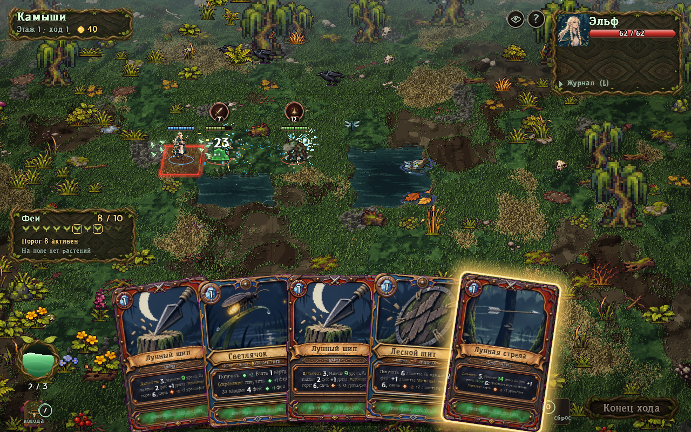
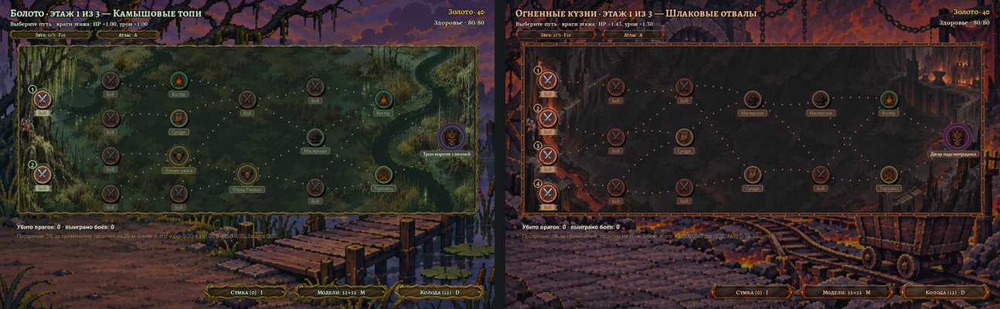
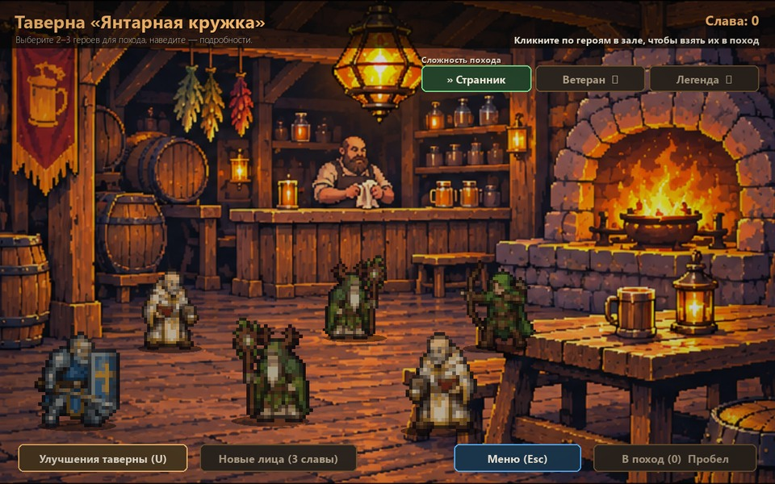
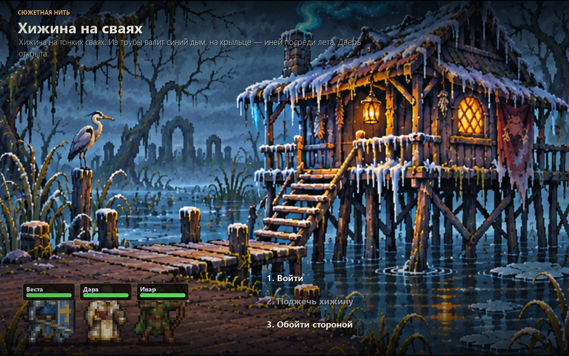
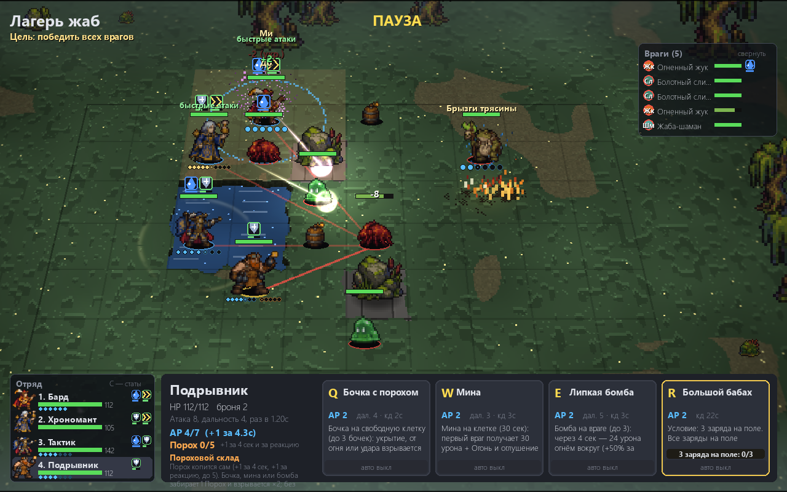

# Хроники янтаря

Фэнтезийный тактический рогалик с пиксельной графикой. Собирайте колоду для одного героя в **«Спуске»**, ведите отряд из четырёх героев в **«Экспедиции»** или испытайте его в **«Бесконечном забеге»**.

## Быстрый запуск

```bash
git clone --branch main https://github.com/ler1223/amber-chronicles.git
cd amber-chronicles
python -m pip install -r requirements.txt
python descent.py --window
```

| Команда | Что открывает |
| --- | --- |
| `python descent.py` | «Спуск» в полноэкранном режиме |
| `python main.py` | Главное меню отрядных режимов |
| `python main.py --expedition` | «Экспедицию» |
| `python main.py --solo` | «Бесконечный забег» с отрядом из четырёх героев |
| `python main.py --sandbox` | Песочницу с открытым контентом и отдельным профилем |
| `python main.py --cpu` | Главное меню с программной отрисовкой |

Команды выполняются из корня репозитория. Запуск проверялся на Python 3.13. **F11** переключает полноэкранный режим.

## Спуск

**Один герой, пошаговый бой и колода, которая меняется по ходу забега.** На карте подземелья вы выбираете, идти ли к элите за наградой, восстановиться у костра или свернуть к торговцу. Путь начинается в болоте и продолжается в Огненных кузнях.



- **Читайте поле перед розыгрышем.** Враги заранее показывают намерения. Можно покинуть отмеченную клетку, спрятаться от стрелка или вытолкнуть противника на лёд. Масло вспыхивает, туман ослабляет дальние атаки, а трещины копят заряд и лопаются под врагом.
- **Решайте, как применить карту.** У ряда карт есть основное действие за ресурс и простое за ноль. Простым применением можно, например, сделать шаг и выйти из опасной зоны, оставив энергию на атаку.
- **Собирайте колоду вокруг условий.** Теги связывают карты с предметами. «Сохранение» оставляет карту в руке, «Изгнание» убирает её до конца боя, а прозрения могут дать знакомой карте другое применение. Карты и предметы можно изучить в атласе.

| Герой | Вокруг чего строится колода |
| --- | --- |
| Наёмник | Разгон от движения, атаки вблизи и стойки, включая шаг конём и защитную стойку |
| Охотница | Метки, капканы и баллиста, которую можно заряжать, усиливать и наводить на линию |
| Пиромантка | Варианты розыгрыша за разное количество жара и духи, которые срабатывают при сохранении и объединяются в руке |
| Жрец | Идолы Перуна, Велеса и Мокоши, свитки и отдельный запас шагов |
| Эльф | Феи, которые усиливают карты на порогах, растения с несколькими стадиями роста, звери и сборка оружия |



**Управление.** Выберите карту **ЛКМ**, затем укажите цель. **ПКМ** переворачивает карту для простого применения, **Пробел** завершает ход. **F2** открывает атлас, а **Esc → Настройки** позволяет выбрать шрифт интерфейса.

[Дизайн поля](docs/descent_field.md) · [Теги и прозрения](docs/descent_tags.md) · [Механики Эльфа](docs/descent_elf_fae.md)

## Экспедиция

**Поход отряда с боями в реальном времени и тактической паузой.** Соберите четырёх героев в таверне, подберите способности и снаряжение, затем выберите главу и маршрут. На развилках встречаются события, торговцы, лагеря и элитные противники. Акт завершается боем с боссом.

| Таверна «Янтарная кружка» | Событие на маршруте |
| --- | --- |
|  |  |

В бою можно поставить время на паузу, перераспределить отряд и подготовить последовательность действий. Сочетания стихий дают реакции, а укрытия, зоны и столкновения влияют на расстановку. В Полигоне можно проверить отряд, навыки и снаряжение в тренировочном бою.



[Дизайн героев](design_characters.md) · [Дизайн глав](design_chapters.md)

## Бесконечный забег

Отряд тоже состоит из четырёх героев, но в бой каждый берёт **одну выбранную способность**. Сборка держится на том, как эти четыре способности сочетаются в отряде. После третьего акта маршрут продолжает генерироваться, а здоровье и урон врагов растут. Запуск из меню или через `python main.py --solo`.

## Разработка

Проект написан на Python. За отрисовку и ввод отвечает **pygame-ce**. В отрядных режимах доступен рендер OpenGL через **ModernGL**.

| Путь | Что там |
| --- | --- |
| [`deck/`](deck/) | Колоды, пошаговый бой, герои и экраны «Спуска» |
| [`sim/`](sim/) | Правила боя, поле, отряды и прогрессия походов |
| [`game/`](game/) и [`ui/`](ui/) | Экраны, отрисовка поля, интерфейс и эффекты |
| [`data/`](data/) и [`assets/`](assets/) | Игровые данные, иллюстрации, спрайты и звук |
| [`tools/`](tools/) и [`tests/`](tests/) | Инструменты разработки и автоматические проверки |

```bash
python -m pip install pytest
python -m pytest tests
```

Проект в разработке. Управление, баланс и набор контента меняются между версиями.
