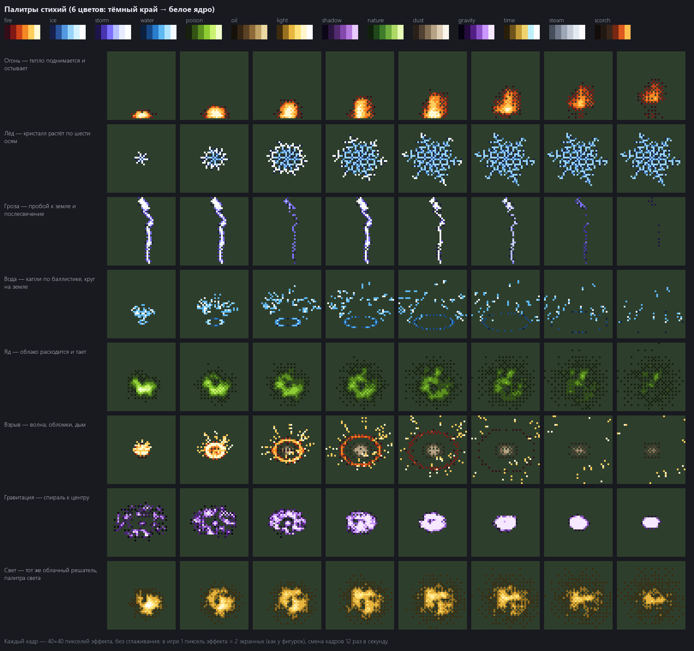
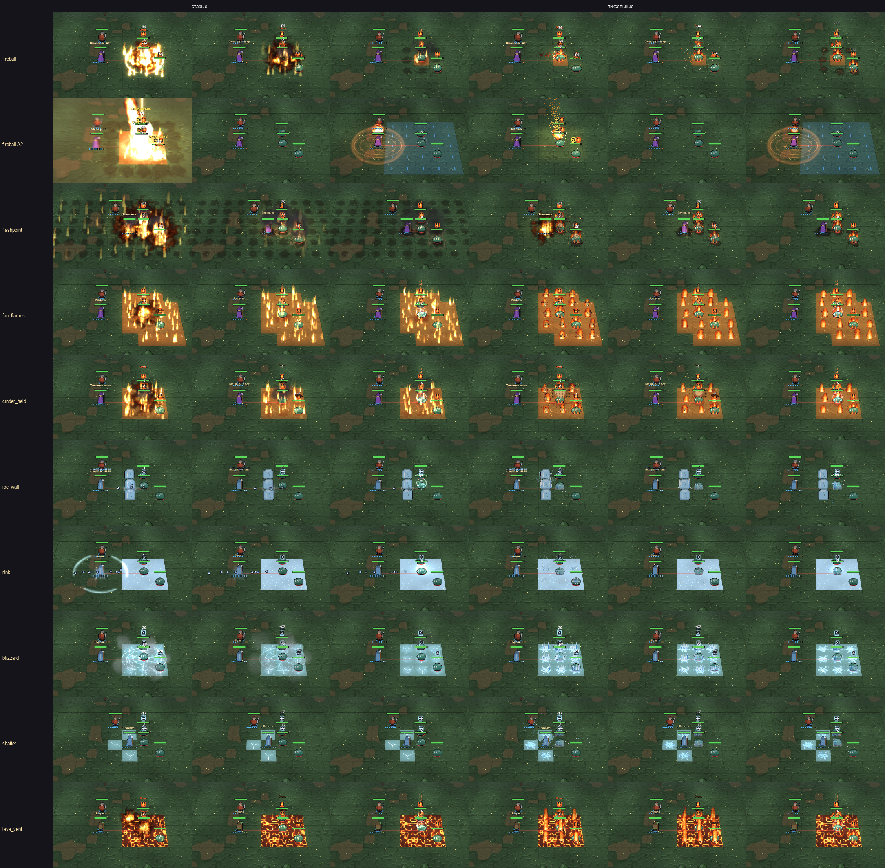
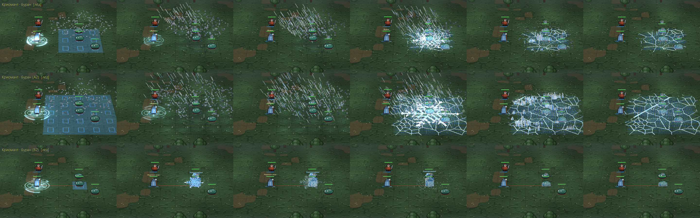

# Арт-стиль эффектов: «физика → пиксель»

Стиль-гайд для переделки визуала. Пилот (огонь и лёд) уже в игре — см. раздел 11.
Лист-образец: `assets/style/style_sheet.png` (собирается `python tools/style_sheet.py` тем же способом, который
предлагается для игры).

---

## 1. Главный принцип

**Одна пиксельная сетка на весь кадр.** Сейчас в кадре три языка: фигурки — крупный пиксель, земля — мелкий
пиксель с размытием, эффекты — гладкие формы со свечением. Новый стиль сводит всё к одному:

- **Явление сначала грубо симулируется физически**: тепло поднимается и остывает, облако расходится и тает,
  кристалл растёт по осям, разряд ищет путь к земле, капли летят по баллистике, обломки — по дугам.
- **Результат запекается в пиксель**: палитра стихии из 6 цветов, упорядоченный дизеринг вместо плавной
  прозрачности, кадры вместо плавной анимации.
- Художник не нужен: всё задаётся правилами и параметрами, вариации — через зерно случайности.

## 2. Сетка, масштаб, кадры

| Правило | Значение |
|---|---|
| Пиксель эффекта | 2 экранных пикселя — как у фигурок (32×32 → 64 px) |
| Сглаживание | нет; масштаб только «ближайшим соседом» |
| Смена кадров | 12 в секунду («на двойках»); движение снаряда по экрану — плавное, сама форма — покадровая |
| Шейдерные эффекты (кольца, лучи, свет) | остаются, но проходят **постеризацию** в палитру и дизеринг |
| Свечение (bloom) | только от двух верхних цветов палитры, мягкое; никаких «засветов» на полкадра |
| Свет на земле и фигурках | 3 ступени яркости, а не плавный градиент |

## 3. Палитры

У каждой стихии и школы — **6 цветов от тёмного края к белому ядру** (верхняя строка листа). Эффект использует
только свою палитру; белое ядро — только в самый яркий момент (кадр удара).

| Палитра | Где |
|---|---|
| fire | огонь, взрывы, лава |
| ice | лёд, иней, заморозка |
| storm | гроза, электрошок |
| water | вода, святая вода, прилив |
| poison | яд, кислота |
| oil | масло, грязь |
| light | свет, лечение, святое |
| shadow | тьма, проклятия, тень ассасина |
| nature | корни, рост, друид, шаман-природа |
| dust | физика: удары, столкновения, обломки, дым |
| gravity | гравитация, порталы |
| time | время (хрономант): золото + бирюзовый отблеск |

- **Реакции стихий** смешивают две палитры дизерингом (Пар = fire + water, Заморозка = water + ice).
- **Контраст по слоям**: земля приглушённая (насыщенность ниже), эффекты — ярче земли, фигурки — самые
  контрастные контуры в кадре. Эффект не красит фигурку в свой цвет больше чем на одну ступень.
- **Цвет стороны**: телеграфы врага — красно-оранжевый контур, свои — голубой; эти два цвета эффекты стихий не
  используют для заливок крупных площадей.

## 4. Язык форм по стихиям

Чтобы стихии различались не только цветом, у каждой своя симуляция, своё движение и свой след на земле.

| Стихия | Симуляция | Форма | Движение | След на земле |
|---|---|---|---|---|
| Огонь | тепло поднимается, сносится, остывает | рваные языки вверх | вверх, мерцание | подпалина, угли тлеют |
| Лёд | рост кристалла по 6 осям (дендрит) | острые грани, ветви | рост → застывание → раскол | иней с гранями |
| Гроза | пробой к земле (ветвящийся рост) | изломанные линии | вспышка, мигание, послесвечение | обугленный крест |
| Вода | капли по баллистике + волна | дуги, капли, эллипсы | всплеск вверх, падение | лужа, круги |
| Яд | облако: клубы расходятся и тают | клубящиеся пятна | медленно вширь | ядовитая лужа |
| Масло | вязкая капля растекается | тяжёлые кляксы | растекание | маслянистое пятно |
| Свет | частицы-пылинки + лучи | лучи из центра, кольца | вспышка и медленные пылинки | светлый круг-глиф |
| Тьма | облако «наоборот» (стягивается) | рваные тени | к центру, дрожь | тёмное пятно |
| Природа | рост ветвей (L-система) | изгибы, листья | прорастание из земли | корни, трава |
| Физика | обломки по дугам + пыль | осколки, полосы удара | удар, разлёт, оседание | трещины |
| Гравитация | частицы по спирали (момент сохраняется) | спираль, сжатие | к центру, ускоряясь | вмятина |
| Время | кольца + «тиканье» | концентрические круги | пульс, отмотка назад | часовой глиф |

**Ветки навыков меняют форму, а не только размер**: «Метеор» — падение с неба и кратер, «Огненные стрелы» —
три языка-снаряда, «Ледяная тюрьма» — кристалл вокруг цели. Масштаб от ступени и рун — поверх.

## 5. Тайминг удара

Каждый заметный эффект — три фазы, доли от длительности:

| Фаза | Доля | Что видно |
|---|---|---|
| Замах (антиципация) | ~25% | сбор: частицы к центру, сгущение цвета, тень будущей формы на земле |
| Удар | ~10% (1–2 кадра) | самый яркий кадр, белое ядро, форма во всю величину, стоп-кадр и тряска — как сейчас |
| Затухание | ~65% | послесвечение, дым, оседание частиц, след на земле |

## 6. Размеры

| Класс | Когда | Радиус | Высота над землёй |
|---|---|---|---|
| S | обычная атака, статус | ≤ 0.5 клетки | до пояса фигурки |
| M | навык 2–3 AP | 1 клетка | до головы |
| L | навык 4+ AP, вторая ступень ветки | 2 клетки | выше головы |
| XL | только боссы и редкие финалы (Ритм, Коллапс) | 3+ клетки | до края кадра |

## 7. Читаемость

- Под юнитами — всё плоское (круги, лужи, трещины, глифы), над юнитами — объёмное (снаряды, вспышки, дым).
- Силуэт фигурки не закрывается непрозрачным эффектом дольше 0.3 сек; фигурки просвечивают сквозь эффекты
  (уже сделано).
- Пауза гасит эффекты экрана и приглушает свечение (уже сделано); значки состояний и полоски — поверх всего.
- Плотность: не больше ~30% кадра поля заняты эффектами одновременно; лишние частицы отбрасываются по
  приоритету (свои навыки и вражеские телеграфы — главнее окружения).

## 8. Как это строится (пайплайн)

1. **Симуляторы** (numpy, вне игры): по одному на явление — огонь, облако, кристалл, разряд, капли, обломки,
   спираль, рост ветвей. Параметры: размер, длительность, плотность, ветер, зерно.
2. **Запекание**: симуляция → кадры 12/с → палитра стихии + дизеринг → атлас флипбуков в кэше
   (`assets/cache/`, как сейчас), по 3–4 варианта зерна на эффект, чтобы не повторялось.
3. **В бою**: флипбук играет кадры без сглаживания; снаряды и частицы — пиксельные спрайты из тех же палитр;
   шейдерные эффекты рисуются в буфер половинного разрешения и постеризуются в палитру.
4. **Описания эффектов** (`data/vfx.json`) остаются, но вместо «текстуры» ссылаются на «явление + палитру +
   параметры».

## 9. Порядок внедрения

0. **Основа**: буфер эффектов в пиксельной сетке, постеризация и дизеринг, палитры в данных, 12 кадров/с.
1. **Пилот: огонь и лёд целиком** — все навыки, статусы, клетки, реакции этих стихий. Сравнение со старым в игре.
2. **Остальные стихии** по утверждённому образцу.
3. **Окружение и статусы**: огонь на клетках, лужи, иней, частицы глав.
4. **Чистка**: старые гладкие текстуры и лишние режимы шейдеров убираются.

Критерии пилота: стихию узнаёшь по форме без цвета (на ч/б скриншоте), фигурки читаются в самый яркий кадр,
эффект не выбивается из пиксельной сетки фигурок.

## 10. Открытые вопросы

- Фигурки пока остаются как есть; если позже будет генератор фигурок с кадрами анимации — тайминг эффектов
  (раздел 5) подстраивается под их кадры замаха и удара.
- Земля сейчас мельче пикселем, чем фигурки и эффекты (1 пиксель земли ≈ 1 экранный в центре поля). Довести её до
  той же сетки (2 экранных) — отдельный шаг после пилота.

## 11. Пилот: огонь и лёд (сделан)

Лист: каждый навык огня и льда в окне превью, три момента после удара; слева старые эффекты, справа пиксельные.

| Файл | Что делает |
|---|---|
| `ui/pixfx_sim.py` | симуляторы явлений (numpy) и запекание в палитру с дизерингом; ими же рисуется лист-образец |
| `ui/pixfx.py` | рецепты эффектов, 3 варианта зерна, кэш увеличенных кадров (ступени 0.25), экземпляры и снаряды |
| `ui/pix_battle.py` | где что играет в бою; если пилот нарисовал своё — старый эффект не играется |

- **Навыки**: стихия определяется по эффектам навыка (урон, тег, опасность, рельеф, стена, детонация), а не
  по названию — новые навыки огня и льда подхватываются сами. Снаряд — огненный шар с клубами жара (лёд —
  осколок, поворот ступенями по 45°), метеор падает с неба. Удар огня — взрыв по площади, малые взрывы по
  клеткам, подпалины на земле (остаются), свет и тряска. Удар льда — кристалл-дендрит, шипы из земли по
  клеткам волной от центра, иней (тает за 5 сек). Навыки без урона (стена, каток, раздуть, вспышка) дают
  только всплеск в точке — остальное показывает сам результат.
- **Каст**: над головой копится пиксельный шар огня или кристалл льда вместо гладкой сферы.
- **Статусы**: горящий — языки пламени за спиной и огоньки у ног (силуэт не закрыт); охлаждённый — лёд по
  колено; вморожен — гранёная глыба.
- **Клетки**: горящая — одно пламя-петля на клетку (сдвиг, чтобы не стояли по линейке); ледяная — иней.
- **Реакции и события**: таяние, пар, заморозка, вспыхнувшее масло, раскол, перегрузка, токсичный огонь,
  детонация, мины, взрыв бочки, огонь и лёд на клетках, лава и каток, ледяная стена, извержение и лавина.
- **Свечение**: только два верхних цвета палитр, отдельным слоем в bloom (слой отдаётся видеокарте, только
  если в кадре есть пиксельный эффект).
- **Пауза**: пиксельные эффекты становятся прозрачнее, как и остальные.
- **Сравнение**: F9 в бою или «Настройки → Пиксельные огонь и лёд»; бой не меняется, меняется только вид.
- **Цена**: ~0.4 сек на запекание при первом бое, кадр +3 мс.

Что осталось старым и ждёт следующих шагов: магический круг каста под ногами, искры и сходящиеся огоньки
каста, вспышки экрана и затемнение (разделы 2 и 9.0 — постеризация шейдерных эффектов).

## 12. Эталон: живые частицы и удар о поверхность

После пилота: взрыв не должен быть «шаром в воздухе». Так устроены попадания в играх: снаряд — голова и хвост,
удар — короткая вспышка в точке контакта, брызги и обломки летят **от поверхности** (конусом), последствия
(дым, след на земле) остаются на месте удара. Поэтому эталонные заклинания переведены на живые частицы.

| Файл | Что делает |
|---|---|
| `ui/pixsim.py` | частицы в координатах поля (x, y, высота): гравитация, плавучесть, сопротивление, остывание по палитре, удар о землю (погаснуть / отскочить / лечь); рисуются квадратами в пиксельной сетке с дизерингом, по глубине вместе с фигурками |
| `ui/pix_spells.py` | эталонные снаряды и удары |

| Заклинание | Полёт | Удар |
|---|---|---|
| Огненный шар | по прямой, ядро + хвост кометы (у головы толще и жёлтый, к концу тоньше, краснеет, уходит в дым) | вспышка на теле цели; брызги назад от удара и вокруг цели падают и тлеют; цель вспыхивает снизу вверх; горящие капли летят дугами на клетки площади — клетка и стоящий на ней загораются, **когда капля упала** |
| Метеор | падает сверху-сзади по крутой прямой, толстый хвост | удар в землю: волна огня стелется по земле, из фронта поднимаются языки; ударная волна пыли; комья и раскалённые обломки по дугам; столб дыма; воронка-подпалина; капли поджигают клетки |
| Ледяная игла / ледяные снаряды | осколок, повёрнутый по ходу; холодная дымка **оседает** за ним | осколки по ходу удара (часть — назад), отскакивают от земли и лежат; кристалл растёт из точки контакта на теле; пар оседает; по площади — шипы волной от точки удара и иней |
| Дальние атаки огнём и льдом | то же, мельче | то же, мельче |

- **Что видно, то и случилось**: симуляция ставит огонь, заморозку и статус в момент каста, а вид — по прилёте:
  пламя клеток и фигурок, глыба заморозки и оттенок ждут снаряд (или упавшую каплю).
- Уже горевшее до выстрела не гаснет на время полёта.
- Навык по клетке, на которой кто-то стоит, бьёт в него, а не в землю под ним.
- Остальные навыки огня и льда — пока на пиксельном пилоте (раздел 11); переводятся по этому образцу после отзыва.
- Цена: кадр +2 мс в тяжёлом бою (до ~550 частиц).

Ленты кадров эталона: `assets/style/ref_fireball.png`, `ref_meteor.png`, `ref_ice.png`.

## 13. Удар как разрыв, живой огонь на поле и на фигурках

**Удар огненного шара** — по образцу разрыва боевой части (выстрел из РПГ), а не облако частиц:

| Фаза | Время | Что видно |
|---|---|---|
| Вспышка | 1 кадр | плотный белый диск в точке контакта, стоп-кадр 0.035 сек |
| Осколки | 0.1–0.25 сек | искры-**штрихи** с огромной скоростью полусферой от поверхности (от цели к стрелку и в стороны; от земли — вверх), белое → жёлтое → оранжевое |
| Ударная волна | 0.13 сек | кольцо огня в плоскости поверхности вокруг точки удара |
| Огненный клуб | 0.45 сек | вырывается и сразу тормозит, всплывает, уходит в копоть |
| Последствия | 1.4 сек | тёмный дым поднимается, угли падают и тлеют; раскалённые осколки летят на клетки площади и поджигают их |

**Горящие клетки** — одна горящая поверхность (как огонь Doom PSX: поле жара → палитра):
- все горящие клетки — одно поле жара (32 пикселя эффекта на клетку): соседние клетки сливаются без швов,
  край общий, скруглённый и живой (медленный шум съедает и отпускает границу) — `ui/pixfire.py`;
- земля под огнём обуглена: тёмная палитра подпалины, угли тлеют редкими бегущими пятнами;
- пламя — **отдельные языки**, как у настоящего огня: ~7 корней на клетку, каждый живёт 1–2 сек и
  покачивается; из корня поток жара — у основания широкий и жёлтый, к кончику тоньше и краснее, коптит;
- редкие искры улетают высоко.

**Горящий юнит** — мелкие огоньки по модели, а не столбы: 5 корней на контуре и теле фигурки (берутся из
маски картинки, не с макушки), живут ~1 сек и переползают; на каждом — маленький язычок пламени (8×12
пикселей эффекта), плюс редкие угольки. Огонь едет вместе с фигуркой.

Источники идей: [огонь Doom PSX](https://fabiensanglard.net/doom_fire_psx/) (поле жара + палитра),
[огонь Noita](https://80.lv/articles/noita-a-game-based-on-falling-sand-simulation/) (каждый горящий пиксель
поджигает соседей — площадь горит целиком), разрыв боевой части с ударным взрывателем (вспышка, осколки,
ударная волна, дым).

### Масштаб и сила удара

Разрыв один и тот же по форме, но его размер — по классу навыка (раздел 6): масштаб s растёт с площадью
навыка и ступенью ветки; размеры частиц ~ s, их число ~ s^1.5.

| Навык | s | Что добавляется |
|---|---|---|
| Дальняя атака огнём | ~0.6 | только разрыв на теле |
| Огненный шар (радиус 1) | ~1.6 | огонь стелется по земле до края площади, пыль ударной волны впереди огня, осколки поджигают клетки |
| Огненный шар по земле | ~1.5 | то же из точки на земле, воронка |
| Метеор (радиус 2) | ~3.4 | XL: белый удар на всю площадь, раскалённые обломки, гриб дыма, аберрация |

- **Выстрел**: вспышка у руки и короткий конус искр к цели — снаряд вырывается, а не появляется.
- **Раскалённая оболочка**: белая, расширяется за 2 кадра — даёт размер удара, затем огненный клуб.
- **Для глаза**: свет на поле (радиус 150 + 110·s), тряска, стоп-кадр 0.03 + 0.02·s, вспышка экрана, толчок
  камеры к точке удара; свечение пиксельного слоя сильнее (0.95).
- Лёд — так же: крупнее кристалл в точке контакта, больше осколков, ледяная крошка штрихами по ходу удара,
  по площади — большие шипы в центре и волна пара до края.

## 14. Следы удара и поверхности (огненный шар, метеор)

Клетки — инструмент игрока, для мира их нет. Поэтому **один удар — один след** (`ui/pixmarks.py`), а не
отметина на каждой клетке:

- воронка в центре (у удара в землю), копоть с рваным краем, лучи выброса — гуще по ходу удара и тянутся за
  край; там, куда упали раскалённые осколки, — вытянутые по ходу разлёта рваные брызги копоти, связанные с
  центром тонкими лучами. Всё — одно пятно;
- клетка под пикселем решает только, **как** выглядит выжженное здесь:

| Поверхность | След | Реакция на удар |
|---|---|---|
| Трава / земля | обугленная земля (тёмные коричневые) | огонь стелется, пыль ударной волны |
| Камень | серая копоть | то же |
| Лёд | не коптится: мокрое подтаявшее пятно и трещины | осколки шипят паром |
| Вода | **следа нет** | столб брызг, капли падают обратно, круги по воде расходятся; огонь по воде не идёт — шипит паром; над водой вместо копоти пар |
| Лава | **следа нет** | осколки плюхаются тяжёлыми раскалёнными каплями |
| Пропасть | **следа нет** | — |

- Горящая поверхность (раздел 13) — тоже пятном: край общий, рваный, живой, одна горящая клетка — пятно,
  а не квадрат.
- Масштаб удара даёт **количество** частиц, а не их размер: пиксели не крупнеют больше чем в 1.6 раза —
  у метеора огонь мельче и гуще, а не из больших квадратов.
- Пока так сделаны только огненный шар и метеор.

## 15. Пилот льда: Буран по образцу огненного шара

| Фаза | Что видно |
|---|---|
| Выстрел | вспышка инея у руки, конус ледяных искр к цели |
| Полёт | гранёная ледяная глыба по прямой, холодная дымка **оседает** за ней |
| Удар | морозный разрыв у земли: белая оболочка холода, ледяная крошка штрихами, куски льда скачут по земле |
| Мороз ползёт | фронт идёт по земле до края площади, оставляет искрящиеся кристаллы; холодный пар катится впереди и оседает; над лавой — только пар |
| Шипы | прорастают в случайных точках площади (не по клеткам) волной от точки удара, крупные — у центра |
| Буран | снег крутит над площадью и сыплется ветром наискось |
| Последствия | **один** морозный след на весь удар (иней на земле, корка с трещинами на воде), тает за 8 сек; ледяные клетки — единая наледь с трещинами и бегущим бликом, земля сквозь неё видна |

Ледяные клетки любых навыков теперь тоже рисуются единой наледью (`IceField`, `ui/pixfire.py`), как горящие — единой
горящей поверхностью. Ветки Бурана: A2 — то же на радиусе 2, B2 («Ледяная игла») — снаряд в цель.

